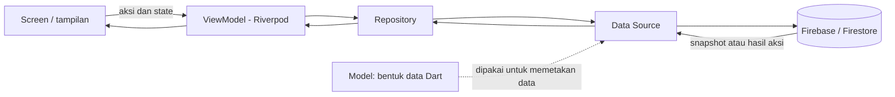

# Panduan Memahami Nihong Jastip Mobile

> Panduan ini ditulis untuk mulai belajar Flutter dari project yang sudah ada. Tidak perlu langsung paham semua file. Ikuti bagian “urutan belajar” di bawah, lalu buka contoh file yang disebutkan.

## 1. Project ini untuk apa?

Ini aplikasi operasional internal Nihong Jastip untuk Android dan iOS. Aplikasi Flutter ini berada di folder/repository terpisah dari web `nihong-team`. Keduanya berbagi data Firebase dan Firestore, tetapi source code-nya berbeda.

Saat ini fitur yang sudah memiliki alur utama:

- Login admin dengan Firebase Authentication.
- Dashboard, daftar pesanan, pelanggan, jadwal keberangkatan, dan booking.
- Checklist barang pada booking dan konversi booking menjadi pesanan.
- Inbox pesanan NihongStore, termasuk pengecekan stok, penolakan, serta pemasangan ke jadwal.
- Pembatalan booking NihongStore dengan sinkronisasi status ke dua project Firebase.

Beberapa menu masih placeholder: Kas, direktori Jastiper, dan halaman link publik. Ada model ledger, tetapi itu belum berarti fitur Kas sudah jadi. Route dan placeholder bisa dilihat di [router.dart](../lib/app/router.dart).

## 2. Teknologi yang dipakai

| Teknologi | Dipakai untuk |
|---|---|
| **Dart** | Bahasa pemrograman aplikasi. |
| **Flutter** | Membuat tampilan dan aplikasi Android/iOS dari satu codebase. |
| **Material widgets** | Komponen UI seperti `Scaffold`, `AppBar`, `Card`, tombol, form, dan bottom navigation. |
| **Riverpod** (`flutter_riverpod`) | Menyimpan dan membagikan state aplikasi, misalnya daftar booking yang sedang tampil. |
| **go_router** | Mengatur URL/route, perpindahan halaman, tab navigasi, dan proteksi halaman login. |
| **Firebase Core** | Menginisialisasi koneksi Firebase di aplikasi. |
| **Firebase Authentication** | Login admin menggunakan email dan kata sandi. |
| **Cloud Firestore** | Membaca dan menyimpan data pelanggan, pesanan, jadwal, booking, dan inbox. |
| **intl** dan `flutter_localizations` | Format tanggal/bahasa, terutama nama bulan Bahasa Indonesia. |

Daftar data menggunakan batas awal **15 dokumen**. Saat pengguna scroll ke bagian bawah, aplikasi meminta tambahan 15. Ukuran ini didefinisikan di [firestore_page_size.dart](../lib/core/firestore/firestore_page_size.dart), sedangkan footer pemuatan ada di [load_more_tile.dart](../lib/core/widgets/load_more_tile.dart). Pencarian dan filter daftar bekerja pada data yang sudah dimuat; kalau hasil belum ditemukan, gunakan footer “Muat 15 data lainnya”.

Daftar versi paket ada di [pubspec.yaml](../pubspec.yaml). Syarat Dart project saat ini `^3.12.2`; versi SDK yang terpasang bisa dicek dengan `flutter --version`.

## 3. Gambaran arsitektur

Bayangkan sebuah restoran: layar adalah meja pemesan, ViewModel mengatur pesanan yang sedang diproses, Repository menjadi pintu akses data, Data Source berbicara langsung dengan Firebase, dan Model adalah bentuk data yang dipahami aplikasi.



Pola folder per fitur kira-kira seperti ini:

```text
lib/features/pre_orders/
├── data/
│   ├── models/                  # bentuk data booking
│   ├── pre_order_data_source.dart # komunikasi Firestore
│   └── pre_order_repository.dart  # pintu data untuk ViewModel
└── presentation/
    ├── providers/               # state dan aksi halaman
    └── screens/                 # halaman/form yang dilihat pengguna
```

Tidak setiap fitur wajib memiliki semua lapisan. Contohnya fitur perhitungan pesanan punya folder `domain/` untuk aturan hitung, sedangkan sebagian fitur baca data lebih sederhana.

## 4. Cara menjalankan project

Buka Terminal, masuk ke folder mobile (bukan folder web), lalu jalankan:

```bash
cd /Users/CANDY/Projects/Pribadi/nihong-mobile
flutter pub get
flutter devices
flutter run
```

`flutter devices` menampilkan emulator atau perangkat yang tersedia. Kalau ada lebih dari satu, pilih satu dengan `flutter run -d ID_PERANGKAT`.

Perintah yang sering dipakai:

```bash
flutter analyze                 # cek masalah statis pada Dart/Flutter
dart format lib/nama_file.dart  # rapikan satu file Dart
flutter run                     # jalankan aplikasi untuk pengembangan
```

Saat aplikasi sedang berjalan di terminal, `r` biasanya melakukan hot reload; `R` melakukan hot restart. Hot reload membantu melihat perubahan UI tanpa membuka ulang aplikasi.

## 5. Mulai aplikasi dan perpindahan halaman

Urutan saat aplikasi dibuka dimulai di [main.dart](../lib/main.dart):

1. Menyiapkan Flutter dan format tanggal Indonesia.
2. Menginisialisasi Firebase utama.
3. Menginisialisasi aplikasi Firebase kedua untuk NihongStore.
4. Menjalankan aplikasi di dalam `ProviderScope` agar Riverpod bisa digunakan.

[app.dart](../lib/app/app.dart) membuat `MaterialApp.router`, mengatur tema dan locale Indonesia. [router.dart](../lib/app/router.dart) menentukan route seperti `/login`, `/orders`, `/preorders`, dan `/schedules`. Route admin mengarahkan pengguna yang belum login ke halaman login.

Tab bawah dibuat di [app_shell.dart](../lib/features/navigation/presentation/app_shell.dart). Bagian `StatefulShellRoute.indexedStack` menjaga tab yang sudah dibuka tetap ada saat pengguna berpindah tab.

## 6. Contoh alur kode: daftar booking

Saat belajar, ikuti satu fitur dari layar sampai data. Booking adalah contoh yang cukup lengkap.

### A. Screen menampilkan state

Di [pre_orders_screen.dart](../lib/features/pre_orders/presentation/screens/pre_orders_screen.dart), layar membaca state dari Riverpod:

```dart
final state = ref.watch(preOrdersViewModelProvider);
final viewModel = ref.read(preOrdersViewModelProvider.notifier);
```

- `ref.watch(...)`: layar berlangganan state. Kalau state berubah, bagian UI akan dibangun ulang.
- `ref.read(...)`: mengambil objek untuk memanggil aksi satu kali, misalnya mengubah pencarian atau menyimpan data.

### B. ViewModel mengurus state dan aksi

[pre_orders_view_model.dart](../lib/features/pre_orders/presentation/providers/pre_orders_view_model.dart) menyimpan daftar booking, kata pencarian, filter status, serta error/loading. Contohnya `setQuery()` mengubah kata pencarian. ViewModel juga berlangganan perubahan data dari Repository.

### C. Repository menjadi pintu data

[pre_order_repository.dart](../lib/features/pre_orders/data/pre_order_repository.dart) menyediakan fungsi seperti `watchPreOrders`, `createPreOrder`, dan `convertPreOrderToOrder`. Layar tidak perlu mengetahui detail query Firestore.

### D. Data Source berbicara ke Firestore

[pre_order_data_source.dart](../lib/features/pre_orders/data/pre_order_data_source.dart) berisi query dan perubahan data yang benar-benar dilakukan. Contohnya daftar booking memakai stream snapshot. Pembuatan booking memakai transaksi agar pembuatan booking dan penambahan berat pada jadwal dilakukan bersama.

### E. Model menerjemahkan format data

[pre_order.dart](../lib/features/pre_orders/data/models/pre_order.dart) menerjemahkan dokumen Firestore menjadi object `PreOrder`, lalu object itu bisa dibuat menjadi map untuk disimpan kembali.

Jadi, kalau mau mengubah tampilan kartu booking, mulai dari screen. Kalau mau mengubah data yang disimpan atau aturan transaksi, telusuri sampai Data Source dan Model. Jangan menaruh query Firestore langsung di widget layar.

## 7. Riverpod dengan bahasa sederhana

Riverpod menyambungkan state ke UI. Beberapa istilah yang sering muncul:

- **Provider**: tempat menyediakan object, misalnya Firebase atau Repository.
- **NotifierProvider**: menyediakan ViewModel dan state yang bisa berubah.
- **Notifier**: class yang mengubah state dan menangani aksi pengguna.
- **`state = ...`**: memberi nilai state baru; layar yang `watch` akan memperbarui tampilannya.
- **`ref.watch`**: mengikuti perubahan nilai/provider.
- **`ref.read`**: membaca nilai/provider untuk suatu aksi tanpa berlangganan perubahan.

Contoh pola yang dipakai project: `NotifierProvider<PreOrdersViewModel, PreOrdersState>`. `PreOrdersState` berisi data tampilan; `PreOrdersViewModel` mengubah state dan memanggil Repository.

## 8. Firebase: ada dua project

Bagian ini penting karena aplikasi memakai dua project Firebase:

| Koneksi | Isi utama | Cara diakses |
|---|---|---|
| Firebase utama `nihong-4b93e` | Data operasional Nihong Jastip seperti `customer`, `departure_schedules`, `pre_orders`, dan `orders`. | `FirebaseFirestore.instance` |
| Firebase NihongStore `nihongstore-6210b` | Inbox pesanan dari NihongStore dan daftar admin. | Firebase app bernama `nihongStoreApp`, lalu `FirebaseFirestore.instanceFor(...)` |

Konfigurasi Firebase utama ada di [firebase_options.dart](../lib/firebase_options.dart) dan konfigurasi NihongStore ada di [nihong_store_firebase_options.dart](../lib/core/firebase/nihong_store_firebase_options.dart). Pada Android/iOS, inisialisasi Firebase utama juga menggunakan file konfigurasi native. Jangan mengganti konfigurasi atau nama project tanpa tahu dampaknya ke data.

Login perlu membuka sesi pada project utama dan NihongStore. Project NihongStore juga memeriksa dokumen `admins/{uid}`. Artinya, login berhasil di project utama saja belum cukup untuk membuka inbox NihongStore.

Nama collection dan field Firestore harus dipertahankan dengan hati-hati karena web dan mobile berbagi database. Contohnya, `pre_orders` memakai underscore, sedangkan koleksi pelanggan saat ini bernama `customer` tunggal.

### Stream, Future, dan transaksi

- **`Future<T>`**: satu hasil yang datang nanti, seperti menyimpan booking. Biasanya dipanggil dengan `await`.
- **`Stream<T>`**: rangkaian perubahan dari waktu ke waktu. Firestore `snapshots()` mengirim data lagi saat dokumen berubah.
- **Transaksi (`runTransaction`)**: membaca data terbaru, lalu menulis perubahan terkait sebagai satu operasi yang konsisten. Contoh: booking menambah `beratTerpakai` jadwal. Ini mencegah kapasitas terhitung salah jika beberapa perubahan terjadi hampir bersamaan.

## 9. Dart yang akan sering terlihat

| Bentuk kode | Artinya |
|---|---|
| `final nama = ...` | Nilai variabel ditetapkan sekali dan tidak diganti dengan object baru. |
| `const Text('Booking')` | Widget/nilai konstan yang bisa dibuat saat compile. |
| `String? catatan` | `catatan` boleh berisi teks atau `null` (belum ada nilai). Tanda `?` adalah null safety. |
| `required this.id` | Pemanggil wajib mengisi nilai bernama `id` saat membuat object. |
| `Future<void> simpan() async` | Fungsi asynchronous yang bisa menunggu operasi dengan `await`. |
| `List<PreOrder>` | Daftar object booking. |
| `Map<String, dynamic>` | Data berbentuk pasangan nama field dan nilai, sering dipakai untuk Firestore. |
| `factory PreOrder.fromMap(...)` | Constructor khusus untuk membuat object dari map/dokumen. |
| `_namaFungsi` | Awalan `_` menandakan fungsi/field hanya untuk pemakaian internal library/file Dart. |

Flutter membangun tampilan dari widget. Contoh: `Scaffold` menampung struktur halaman; `Column` menata anak widget vertikal; `ListView` membuat daftar yang bisa digulir; `TextField` menerima input.

## 10. Cara menambah atau mengubah fitur

Untuk perubahan kecil, ikuti urutan ini:

1. Tentukan perilaku yang mau diubah. Cari layar atau route-nya di `lib/app/router.dart`.
2. Ubah UI di `features/<nama_fitur>/presentation/screens/`.
3. Jika perlu state/aksi, tambahkan atau ubah di `presentation/providers/`.
4. Kalau aturan bisnisnya berupa hitungan yang bisa dipisah dari Firebase, letakkan di `domain/` (lihat `features/orders/domain/`).
5. Untuk query atau tulis Firestore, ubah `data/<fitur>_data_source.dart`.
6. Pastikan Model cocok dengan field Firestore dan kontrak aplikasi web.
7. Jalankan `dart format` pada file yang berubah, lalu `flutter analyze`.

Sebelum mengubah field atau nama collection, cari pemakaiannya di aplikasi web juga. Jangan menganggap nama variabel di UI sama dengan nama field database.

## 11. Peta folder penting

| Lokasi | Isi |
|---|---|
| `lib/main.dart` | Titik mulai aplikasi dan inisialisasi Firebase. |
| `lib/app/` | Root widget dan konfigurasi route. |
| `lib/core/` | Tema, warna, mapper Firestore, formatter tanggal, widget umum. |
| `lib/core/firestore/firestore_page_size.dart` | Ukuran batch awal/tambahan daftar: 15 dokumen. |
| `lib/core/widgets/load_more_tile.dart` | Footer indikator dan tombol muat lagi pada daftar. |
| `lib/features/auth/` | Login dan state sesi Firebase. |
| `lib/features/orders/` | Pesanan resmi, perhitungan, layar dan state. |
| `lib/features/pre_orders/` | Booking, checklist, pembatalan, konversi ke pesanan. |
| `lib/features/schedules/` | Jadwal keberangkatan dan detail kapasitas. |
| `lib/features/customers/` | Daftar dan pencarian pelanggan. |
| `lib/features/inbox/` | Inbox NihongStore dan alur penempatan ke jadwal. |
| `lib/features/dashboard/`, `menu/`, `navigation/` | Beranda, menu, dan navigasi utama. |
| `lib/features/public_links/` | Route/layar placeholder untuk tautan publik. |
| `docs/mobile-release-checklist.md` | Signing dan build distribusi Android/iOS. |

## 12. Urutan belajar yang disarankan

1. Buka `lib/main.dart`, `lib/app/app.dart`, dan `lib/app/router.dart` untuk paham aplikasi dimulai dan halaman dibuka.
2. Pelajari dasar Dart: variable, class, list/map, null safety, function, `async` dan `await`.
3. Pelajari widget Flutter dari satu screen: `Scaffold`, `Column`, `ListView`, `Card`, form, dan callback tombol.
4. Baca `pre_orders_screen.dart` sambil melihat `pre_orders_view_model.dart` untuk memahami state Riverpod.
5. Ikuti alur yang sama ke `pre_order_repository.dart`, `pre_order_data_source.dart`, lalu `pre_order.dart`.
6. Setelah nyaman, pelajari transaksi Firestore dan alur dua project Firebase di fitur inbox.

Mulai dengan satu perubahan UI sederhana dan lihat hasilnya dengan hot reload. Setelah itu baru coba perubahan state, lalu perubahan data. Dengan cara ini, error lebih mudah dicari karena bagian yang sedang dipelajari tidak terlalu banyak sekaligus.

## Glosarium singkat

- **Widget**: satu bagian tampilan Flutter, dari teks sampai seluruh halaman.
- **State**: data yang menentukan tampilan saat ini, misalnya daftar, loading, filter, atau pesan error.
- **Repository**: pintu yang dipakai ViewModel untuk meminta atau mengubah data.
- **Data Source**: tempat detail akses ke sumber data seperti Firestore.
- **Firestore document**: satu record data; beberapa document berada di dalam collection.
- **Build**: proses mengompilasi aplikasi menjadi artefak yang bisa dipasang/distribusikan.

